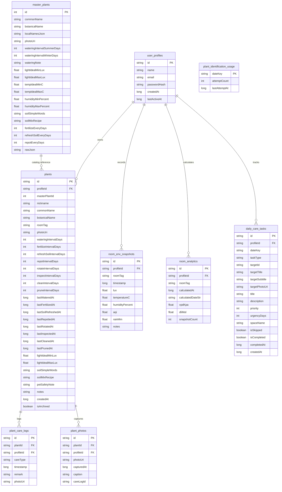

# Happy Plants — Product & Technical Design Document (v0.5)

**Working Title / Package**: *Happy Plants* (`com.hos.happy.plants`)  
**Version**: 0.5 (Updated with Implemented Architecture & Features)  
**Platform**: Android (Target SDK 35, Min SDK 26)  
**Architecture**: Offline-First, Clean Architecture + MVVM, Jetpack Compose, Material 3 Botanical Design System, Room DB (Schema v7), DataStore Preferences  

---

## 1. Executive Summary & Vision

*Happy Plants* is an offline-first companion application tailored for indoor, balcony, and desk plant care in Indian urban environments (Mumbai, Delhi, Bengaluru, Kolkata, Pune, etc.). The app eliminates anxiety around plant care through:

1. **A Calm, Actionable Daily Care Dashboard**: Separating what is **Essential** (e.g. Watering) from what is **Good to Have** (e.g. rotating pots, leaf cleaning).
2. **Environment & Micro-climate Tracking**: Real-time ambient light measurement (hardware lux sensor + CameraX fallback), weather integration, and room-level Vapor Pressure Deficit (VPD) and Daily Light Integral (DLI) calculations.
3. **Master Plant Encyclopedia & Persistent Room Database**: Bundled offline catalog of Indian indoor plant species stored in Room DB (`master_plants`) with resolved Wikipedia images, multi-lingual Indian regional names (Kannada, Tamil, Telugu, Hindi, Marathi, Bengali), seasonal watering guidelines, soil recipes, and common problem diagnostics.
4. **Interactive Plant Care Doctor & Growth Journey**: Step-by-step diagnostic advice for yellowing leaves, pests, and root rot, paired with an animated chronological growth photo slideshow.

---

## 2. Architecture & Design Principles

### 2.1 Core Architectural Pillars
* **100% Offline-First**: No mandatory sign-in, cloud dependency, or external database required for daily logging, plant health diagnostics, or light measurement.
* **Local Multi-Profile Architecture**: Multi-profile system stored in local Room DB (`user_profiles`). Each profile has independent plants, care logs, photos, and environmental snapshots. Profile switching is accessible anytime from the top bar.
* **Reactive State Management**: Built using Kotlin Coroutines, `StateFlow`, and Room Reactive Flows (`Flow<List<T>>`).
* **Hardware Adaptation**: Automatic detection of ambient light sensor capabilities with persistent caching in DataStore, gracefully falling back to CameraX luminance analysis on budget hardware.

### 2.2 Visual Design System (Botanical Palette)
Custom design tokens extending Material 3:
* **Forest (`#2E4A2A`)**: Primary brand color, headings, active bottom navigation icons.
* **Moss (`#4F6F3B`)**: Primary buttons, affirmative actions, active filter chips.
* **Leaf (`#A9C48B`)**: Accents, highlight containers, positive indicator badges.
* **Bark (`#6B4A2F`)**: Secondary text, botanical labels, subtle emphasis.
* **Sand (`#D8C8A4`)**: Card borders, divider lines, subtle outlines.
* **Paper (`#F3EFDF`)**: Warm secondary card surfaces and input backgrounds.
* **PaperDark (`#EDEADB`)**: Overall scaffold background for warm editorial feel.
* **SurfaceWarm (`#F7F5EC`)**: Primary card containers, modals, bottom sheets.
* **Ink (`#2B2118`)**: Primary high-contrast typography.
* **Mute (`#6B5D4D`)**: Secondary body text and hints.
* **AmberLight (`#E89828`)**: Caution, high light, upcoming maintenance indicators.
* **SkyBlue (`#4A89A6`)**: Weather, humidity, and atmospheric metrics.
* **Terracotta / Warn (`#8A4B22`)**: Overdue alerts, essential task highlights.

---

## 3. Database Architecture (Room Schema v7)



### 3.1 Migration History
* **MIGRATION_1_2**: Added `passwordHash` column to `user_profiles`.
* **MIGRATION_2_3**: Created `plants`, `plant_care_logs`, and `plant_photos` tables with foreign keys and indices.
* **MIGRATION_3_4**: Added `rainMm` (REAL) column to `room_env_snapshots`.
* **MIGRATION_4_5**: Created `master_plants` table. `PlantMasterRepository` checks on startup/install and seeds Room DB from `indoor_plants_india.json` with 20 pre-populated species including local names in Kannada, Tamil, Telugu, Hindi, Marathi, and Bengali.
* **MIGRATION_5_6**: Created `plant_identification_usage` table (`dateKey` TEXT PK, `attemptCount` INTEGER, `lastAttemptAt` INTEGER). Tracks daily Pl@ntNet photo identification attempts (capped at 5/day, resetting at 12:00 AM IST).
* **MIGRATION_6_7**: Created `daily_care_tasks` table (`id` TEXT PK, `profileId` TEXT, `dateKey` TEXT, `taskType` TEXT, `targetId` TEXT, `targetTitle` TEXT, `targetSubtitle` TEXT, `targetPhotoUri` TEXT, `title` TEXT, `description` TEXT, `priority` INTEGER, `urgencyDays` INTEGER, `isCompleted` INTEGER, `completedAt` INTEGER, `createdAt` INTEGER). Persists daily evaluated care tasks with Priority 1 (Mandatory Watering), Priority 2 (Weekly Snapshot for occupied spaces), and Priority 3 (Routine care).
* **MIGRATION_7_8**: Added `spaceName` (TEXT DEFAULT '') and `isSkipped` (INTEGER DEFAULT 0) columns to `daily_care_tasks`. Enables hierarchical task grouping by growing space with "Mark all done", and non-destructive swipe-left skipping.

---

## 4. Feature Breakdown & Detailed Mechanics

### 4.0 Global Navigation (Bottom Navigation Bar)
The app utilizes a 4-tab bottom navigation bar (`MainScreen.kt`):
1. **`Task`** (`Icons.Default.Checklist`): Dedicated daily care checklist (`TodayTasksScreen`) matching the visual mockup. Features a small badge circle displaying the active count of pending tasks for today.
2. **`Garden`** (`Icons.Default.Yard`): Dedicated plant collection view (`GardenScreen`) with growing space filters (`All`, `Living`, `Bed`, `Bathroom`, `Balcony`), zero-modal inline plant details, Care Doctor, and Plant Journey slideshow.
3. **`Research`** (`Icons.AutoMirrored.Filled.MenuBook`): Botanical search and Pl@ntNet live camera photo identification.
4. **`Env`** (`Icons.Default.WbSunny`): Hardware light meter, live climate sensors, DLI/VPD calculations, and room environment history.

* **Persistent `+ Add Plant` Button**: Retained on the top app bar across both **`Task`** and **`Garden`** screens, maintaining its attention-grabbing breathing/flashing pulse when the garden is empty.
* **Profile Switcher**: Accessible from the top app bar across screens.

---

### 4.1 Tab 1: Task (`feature/garden/TodayTasksScreen.kt`)

#### B. The 7 Plant Care Activities & Scheduling Engine
Every plant tracks 7 horticultural activities:
1. **Watering (`WATER`)**: The most critical activity.
   - *Golden Rule*: *"Water only when the top 2–3 cm of soil is dry."*
   - *Day 1 Rule*: On initial plant registration, `lastWateredAt = null`. Watering is **immediately scheduled as DUE on Day 1** as an **Essential** task.
2. **Rotating the Pot (`ROTATE`)**:
   - *Golden Rule*: *"Turn the pot a quarter turn weekly so it grows evenly toward light."*
   - *Interval*: 7 days. Initialized as done on Day 1 (`lastRotatedAt = now`).
3. **Feeding (`FEED`)**:
   - *Golden Rule*: *"Manure or diluted fertiliser every 30–90 days during growing season."*
   - *Interval*: Sourced from master plant catalog (default 60 days). Initialized as done on Day 1.
4. **Pest Inspection (`INSPECT`)**:
   - *Golden Rule*: *"A weekly look under leaves and at stems catches problems while easy to fix."*
   - *Interval*: 7 days. Initialized as done on Day 1.
5. **Leaf Cleaning (`CLEAN`)**:
   - *Golden Rule*: *"Wiping dust off leaves opens pores and maximizes sunlight absorption."*
   - *Interval*: 14 days. Initialized as done on Day 1.
6. **Removing Dead Leaves / Pruning (`PRUNE`)**:
   - *Golden Rule*: *"Pruning yellow/brown leaves stops disease spread and saves energy."*
   - *Interval*: 14 days. Initialized as done on Day 1.
7. **Repotting (`REPOT`)**:
   - *Golden Rule*: *"Every 1–2 years so roots have room and soil remains fresh."*
   - *Interval*: Sourced from master data (default 730 days). Initialized as done on Day 1.

#### C. Rules Evaluation Engine & Today's Tasks View
* **Automatic Daily Evaluation (`TaskRuleEngine`)**:
  - Evaluated once every day whenever the app is opened (scoped to `Asia/Kolkata` timezone `dateKey`).
  - Day Rollover: When a new day begins, incomplete tasks from the prior day are removed from today's active deck, and tasks are re-evaluated from scratch based on latest conditions.
* **Horticultural Rules & Priority Hierarchy**:
  - **Rule 1 (`SNAPSHOT` - Priority 2, Weekly Section)**:
    - Weekly snapshot due for any space with $\ge 1$ assigned plants if $\ge 7$ days elapsed. Includes direct shortcut into Environment tab.
  - **Rule 2 (`WATER` - Priority 1, Water Section)**:
    - Seasonal cadence (Summer March-June vs Winter July-Feb). Day 1 immediate trigger on initial plant add. High / Mandatory priority.
  - **Rule 3 (`ROTATE` - Priority 4, Plant Care Section)**:
    - Rotate pot 1/4 turn every 7 days for even sunlight exposure.
  - **Rule 4 (`INSPECT` - Priority 3, Plant Care Section)**:
    - Weekly pest and stem node check under foliage.
  - **Rule 5 (`FEED_MANURE` - Priority 3, Feeding Manure Section)**:
    - Dedicated Feeding Manure section with per-space grouping and `[ Mark all done ]` button. Scheduled every 30–90 days.
  - **Rule 6 (`CLEAN` - Priority 3, Clean Leaves Section)**:
    - Wipe leaf dust every 14 days; shows `High AQI` tag when room/city air quality is elevated.
  - **Rule 7 (`PRUNE` - Priority 4, Plant Care Section)**:
    - Prune yellow/brown dying leaves every 14 days.
  - **Repotting Rule (`REPOT` - Priority 4, Plant Care Section)**:
    - Root inspection and repotting check every 365–730 days.
* **Hierarchical Today's Tasks Layout (`TodayActionsView`)**:
  - **Header Section**: Date, bold `Today` title, progress counter (`X / Y tasks done`), botanical green progress bar, and swipe guide.
  - **Categorized Sections**:
    1. **`💧 Water`** (Rule 2 - Priority 1) with per-space `[ Mark all done ]`.
    2. **`✨ Clean leaves`** (Rule 6 - Priority 3) with `High AQI` badge and per-space `[ Mark all done ]`.
    3. **`🌱 Feeding Manure`** (Rule 5 - Priority 3) with per-space `[ Mark all done ]`.
    4. **`🪴 Plant care`** (Rules 3, 4, 7, Repotting - Priorities 3 & 4).
    5. **`📷 Weekly tasks`** (Rule 1 - Priority 2) featuring white photo row and dark snapshot card.
  - **Gestures**:
    - **Swipe Right**: Reveals green `✓ Done` and records care log.
    - **Swipe Left**: Reveals dark `Skip ✕` and marks task skipped.
  - **Completed Tasks (Revisit Section)**:
    - Displays below pending tasks with green checkmarks and an `[ Undo ]` button.

#### D. Garden Overview: Per-Room Grouping & Inline Expansion (No Modals)
* **Room Filter Chips**: Filter by `All`, `Living`, `Bed`, `Bathroom`, `Balcony`, or custom rooms.
* **Status Badges**: `💧 Thirsty`, `🔄 Rotate`, `🔍 Inspect`, `🌱 Feed`, `✨ Clean`, `✂️ Prune`, `🪴 Repot`, or `🌿 All Good`.
* **Zero-Modal Inline Expansion**: Clicking a card smoothly unfolds an inline accordion directly underneath:
  - **Soil Guidance & Mix Recipe**: Exact component ratios (e.g. *3 parts garden soil + 2 parts coarse sand + 1 part cocopeat*).
  - **7 Activities Calculated Table**: Live countdown showing exact status (e.g. *"🚨 Due Today"*, *"🟢 Due in 4 days"*, *"Overdue by 2d"*) with direct one-tap `"Done"` buttons for every activity.
  - **Recent Care History**: Chronological log of past completed activities.

#### E. 🩺 Care Doctor & Symptom Troubleshooting
* Uses the `common_problems` array from `indoor_plants_india.json`.
* Diagnostic questions prompt the user: *"Are lower leaves turning yellow, soil staying wet, or plant base feeling soft?"*
* Selecting a symptom reveals:
  - Diagnosis (e.g., *Root rot*, *Mealybugs*, *Spider mites*, *Leaf spot*).
  - Numbered, practical remedy steps (e.g., copper oxychloride ratios, neem oil recipe, isolation instructions).

#### F. 🌱 Plant Journey (Animated Slideshow)
* Auto-advancing visual timeline cycling through all photos captured for the plant over time.
* Fades smoothly between stages with capture date, time, and care remarks.
* Full playback controls: Play, Pause, Previous, Next, and photo index indicator.

#### G. Typeahead Add Plant
* Auto-complete search box filtering master plants (seeded in Room DB and backed by `indoor_plants_india.json`) by common name, botanical name, or local Indian nursery names (Tamil, Telugu, Kannada, Hindi, Marathi, Bengali).
* Selecting a plant auto-populates species data, bundled Wikipedia image, and default intervals.
* Allows inline creation of custom growing spaces on the fly.

---

### 4.2 Tab 2: Research (`feature/research`)

#### A. 2-Option Architectural Layout
* **Option 1: Search (`SEARCH`)**:
  - Renamed from "Typeahead Search" to a clean, intuitive **"Search"**.
  - **Prominent Highlighted Search Box**: Styled with an active botanical container, `2.dp Forest` border, subtle elevation, warm paper input surface, and active focus cues so it stands out immediately and never gets lost.
  - Real-time instant filtering against 20 master botanical species (`indoor_plants_india.json` and Room DB `master_plants`).
  - Search indexes English common name (e.g. *Snake Plant*), botanical binomial genus/species (e.g. *Dracaena trifasciata*), and Indian nursery names in **Tamil**, **Telugu**, **Kannada**, **Hindi**, **Marathi**, and **Bengali**.
  - Dropdown suggestion cards display offline bundled image thumbnail, common name, botanical name, and estimated watering interval tag.
  - Quick-start shortcut chips highlighting popular Indian houseplants (*Snake Plant, Money Plant, ZZ Plant, Peace Lily, Areca Palm, Monstera*).

#### B. Pl@ntNet Live Photo Plant Identification (`PlantNetApiService`)
* **Permanent Top Hierarchy**: The *"Find or Identify Any Plant"* search card is permanently anchored at the very top of the Research tab, so users can continuously search or trigger camera/gallery actions without losing context.
* **In-App CameraX Viewfinder (`LivePlantCameraDialog`)**:
  - Replaces external intent launches with an in-app CameraX live viewfinder.
  - Includes runtime camera permission checking, leaf targeting reticle, flashlight/torch toggle, lens flip, and high-resolution capture (eliminating crashes on devices without external camera handlers).
  - Gallery picking via `ActivityResultContracts.PickVisualMedia()`.
* **Daily Identification Limit (5 Attempts/Day, Resets at 12:00 AM IST)**:
  - Daily limit enforced via `PlantIdentificationRepository` and persisted to local Room DB (`plant_identification_usage`).
  - Date rollover calculated in `Asia/Kolkata` timezone (`yyyy-MM-dd`), resetting automatically at 12:00 AM IST.
  - Live quota badge (`X/5 left`) and explanatory note displayed on the search card.
  - If the daily quota is exhausted, camera and gallery buttons are cleanly disabled with an informative prompt.
* **Pl@ntNet API Integration**:
  - Connects to official Pl@ntNet identification endpoint (`https://my-api.plantnet.org/v2/identify/all`).
  - Multi-part form payload with auto-scaling to keep uploads fast and lightweight (< 2 MB).
* **API Key Management & Environment Configuration**:
  - Root `.env` file (`PLANTNET_API_KEY=...`) parsed at build time and injected into `BuildConfig.PLANTNET_API_KEY`.
  - In-app **API Key Dialog** allows users to paste or update their key at any time without rebuilding, stored securely in DataStore preferences (`key_plantnet_api_key`).
* **Clean Identification Results (`IdentifiedPlantCard`) Rendered Below Search**:
  - **Location**: Rendered cleanly **below** the top search card so the user can easily re-search or scan again.
  - **Botanical Badge**: Simple `🌿 Identified Plant` header badge without `% confidence` or `Pl@ntNet AI` match metrics.
  - **No "Scan Another" Button**: Streamlined UI with `+ Add to Garden` as the single full-width primary button.
  - **Reference Image & User Photo**: High-resolution reference photo from Pl@ntNet / Wikipedia side-by-side with user's captured photo.
  - **External Image Fallback**: Automatically queries Wikipedia REST summary API (`https://en.wikipedia.org/api/rest_v1/page/summary/{title}`) to fetch official high-resolution reference images when needed.
  - **Light Conditions**: Clear lux thresholds and sunlight exposure guidance.
  - **Moisture & Watering Needs**: Season-by-season watering intervals and soil dryness checks.
  - **Soil & Potting Mix**: Measured soil blend advice (garden soil, cocopeat, perlite/sand).
  - **Catalog Match Enrichment**: If the identified plant matches a catalog species, seamlessly enriches the result with local Indian nursery names (Tamil, Telugu, Kannada, Hindi, Marathi, Bengali).
  - **"+ Add to Garden" Button**: Direct full-width button opening the Add Plant dialog pre-filled with the identified plant species, photo, and watering schedule.
  - **Privacy & Safety**: Pet toxicity and hazard information remains strictly omitted.

#### C. Comprehensive Master Botanical Inspection View (`PlantDetailView`)
Selecting any plant displays rich encyclopedic data:
* **Offline High-Res Botanical Images**: Offline bundled images generated by `resolve_images.py` located in `assets/images/` loaded directly via `file:///android_asset/images/` (guaranteeing 100% offline, immediate rendering with zero network latency).
* **Botanical Hero Header**: Full-resolution image frame, common name, botanical genus, and regional nursery names chips (Tamil, Telugu, Kannada, Hindi, Marathi, Bengali).
* **Best Growing Conditions**:
  - **Light Range**: Ideal Lux interval + minimum/maximum tolerated extremes (designed for cross-reference with Tab 3 Light Meter).
  - **Temperature**: Ideal (°C) and extreme safety thresholds.
  - **Relative Humidity**: Ideal air moisture percentage and misting recommendations.
* **Care Routine & Watering Schedules**:
  - **Seasonal Watering**: Hot & dry summer frequency (Mar–Jun) vs. monsoon & winter frequency (Jul–Feb).
  - **Horticultural Golden Rule**: Soil moisture check guidance.
  - **Maintenance Intervals**: Fertilizing/manure cadence, top-soil refreshing frequency, and repotting schedule.
* **Soil Mix & Potting Guidance**: Simple language explanation, exact measured potting recipe (garden soil, cocopeat, perlite/sand, compost), and optimal pH limits.
* **Care Doctor Diagnostic Solutions**: Expandable symptom checklist and step-by-step resolution guides for yellow leaves, brown tips, and root rot.
* **Safety Privacy**: Pet safety and plant toxicity information is explicitly omitted from the UI to maintain a calm, positive, non-alarmist horticultural experience.
* **Direct "+ Add to Garden" Integration**: Instantly adds the researched plant directly to the user's active garden profile.

#### C. Option 2: Browse Encyclopedia (`BROWSE`)
* Category filters: `All`, `Low Light`, `Moderate Light`, `Bright Light`, `Low Water`.
* Scrollable encyclopedia list enabling visual browsing and direct inspection of all 20 species.

---

### 4.3 Tab 3: Environment (`feature/env`)

#### A. Master Growing Space Filter & Persistent Space Management
* Default fixed growing spaces: **`Living`**, **`Bed`**, **`Bathroom`**, **`Balcony`**, **`Outdoors`** (defaults to `Living`).
* Custom growing spaces saved to DataStore (`key_custom_room_tags`) and combined dynamically.
* Standardized nomenclature to **"Growing Space"** (with `+ Add Space`) to naturally accommodate indoor rooms, balconies, and open-air outdoor gardens.
* Serves as the master auto-filter across the entire screen (snapshots, historical records, and VPD/DLI metrics).

#### B. Live Macro-Climate & Rain Tracking
* Integrates Open-Meteo REST API using GPS location (`FusedLocationProviderClient`).
* **Live Metrics**: Temperature (°C), Relative Humidity (%), Air Quality Index (AQI), UV Index, Daylight Hours, and Rain/Precipitation (mm + % probability).
* **Rain Weather Card**: Highlights expected daily natural rainfall and outdoor natural irrigation.
* **Database Snapshot Storage**: Persists `rainMm` in `room_env_snapshots` (Room Schema v4 with `MIGRATION_3_4`).

#### C. Dual-Engine Light Meter & Hold Reading
* **Hardware Ambient Sensor**: Real-time reading in Lux via `Sensor.TYPE_LIGHT`.
* **Camera Fallback (CameraX)**: Custom `LuminanceAnalyzer` calculating approximate illuminance for phones lacking a hardware sensor.
* **Hardware Cache**: Queries hardware once on first install, caches result in DataStore, and eliminates redundant SensorManager queries.
* **Freeze / Hold Reading**: Allows user to lock the current reading in place.
* **Dynamic Highlight for Today's Reading**: If no snapshots have been taken for the active growing space today, the **"Hold Reading"** button dynamically flashes with an animated botanical pulse (`LeafBright` glow border, container tint, and scale) to guide the user to lock their reading before saving a snapshot.

#### D. Take Snapshot (Instant Environmental Capture)
* **Streamlined Order**: Positioned immediately underneath the Light Meter so users can seamlessly view/lock the live readings and record a snapshot without having to scroll past analytics.
* **Dynamic First-Snapshot Highlight**: When no snapshot has been captured for the selected growing space today:
  - The card displays an active "First snapshot today" indicator badge.
  - The card border glows dynamically between `Sand` and `Leaf`.
  - The **"Take Snapshot for {Space}"** button pulses with scale (1.04x) and animated color shifts between `Moss` and `LeafBright`, focusing immediate attention on capturing the day's baseline data.
  - Automatically resets to standard state as soon as the day's first snapshot is recorded.

#### E. Advanced Room Analytics: VPD & DLI Daily Unlock (Moved Below Take Snapshot)
* Positioned directly below "Take Snapshot" so users immediately see their new snapshot reflected in the 3-slot daily calculation.
* **Vapor Pressure Deficit (VPD)**: Calculated using the Tetens formula for saturation vapor pressure vs. actual vapor pressure (expressed in kPa).
* **Daily Light Integral (DLI)**: Calculated from average lux, PPFD conversion factor ($54\text{ lx} \approx 1\,\mu\text{mol}\cdot\text{m}^{-2}\cdot\text{s}^{-1}$), and daylight duration (expressed in $\text{mol}\cdot\text{m}^{-2}\cdot\text{d}^{-1}$).
* **3-Slot Daily Measurement Unlock**:
  - Requires 3 measurements in a single day:
    - 🌅 **Morning** (before 12:00 PM)
    - ☀️ **Noon** (12:00 PM – 4:00 PM)
    - 🌇 **Afternoon / Evening** (after 4:00 PM)
  - Interactive stepper displays slot progress and exact recording times.
* **Persistent `room_analytics` Table**:
  - Calculates and stores the latest VPD and DLI values per room and profile.
  - If $\ge 3$ snapshots exist for a room, displays the last calculated values and calculation date immediately upon room selection.

#### F. Last 7 Days Climate & Adaptive Plant Care Guidance (Moved Below Take Snapshot)
* Fetches cumulative 7-day historical weather via Open-Meteo `past_days=7`.
* **7-Day Metrics Tracked**:
  - 🌧️ **Total Rain**: Cumulative precipitation in mm over the last 7 days.
  - ☀️ **Sunlight**: Average sunshine duration in hours/day and total weekly sunlight.
  - 💧 **Mean Humidity**: Average relative humidity percentage over 7 days.
  - 🌫️ **Dust & Air Quality**: Average PM10 dust concentration ($\mu\text{g}/\text{m}^3$) and European AQI.
* **Dynamic Botanical Care Statements**:
  - **Watering Statement**: Adjusts advice based on whether outdoor soil is rain-saturated ($\ge 25\text{ mm}$), moderately moist, or dry.
  - **Sunlight Statement**: Evaluates active photosynthesis ($\ge 6\text{h}/\text{day}$) vs. overcast metabolic slowdown, advising on pot rotation and watering pacing.
  - **Dust & Respiration Statement**: Detects high airborne dust ($\ge 45\,\mu\text{g}/\text{m}^3$) alerting the user to wipe leaves and unclog stomata.
  - **Humidity Statement**: Flags tropical saturation ($\ge 70\%$) vs. crisping dry air ($< 45\%$) with pebble tray and misting recommendations.

#### G. Metric Info Modal (`?` Buttons)
* Non-scientific, plant-friendly explanations for every metric (Temperature, Humidity, AQI, UV, Daylight, LUX, VPD, DLI).
* Features an automatic **5-second countdown timer** that auto-closes the modal.

#### H. Room Snapshot History & Filtered Calendar
* Historical log of recorded room snapshots.
* Date picker with custom date validator enabling **only** dates that have recorded snapshots.

---

## 5. Technology Stack Summary

| Layer | Library / Tool | Purpose |
|---|---|---|
| **Language** | Kotlin 2.0.21 | Android native development |
| **UI Framework** | Jetpack Compose + Material 3 | Declarative, modern botanical UI |
| **Architecture** | MVVM + Repository pattern | Clean separation of business logic and UI |
| **Local DB** | Room 2.6.1 (SQLite) | Profiles, plants, care logs, photos, snapshots, analytics |
| **Preferences** | DataStore Preferences 1.1.1 | Caching hardware capabilities & custom room tags |
| **Image Loading** | Coil Compose 2.7.0 | Loading Wikipedia plant thumbnails & user photos |
| **Camera** | CameraX 1.4.1 | Light meter camera fallback & photo capture |
| **Location** | Play Services Location 21.3.0 | Coarse/fine GPS for macro-climate API |
| **Network** | HttpURLConnection (Standard SDK) | Lightweight Open-Meteo REST calls (zero overhead) |
| **Serialization**| Gson 2.11.0 | Offline parsing of `indoor_plants_india.json` |
| **JVM Target** | Java 17 | JDK 17 LTS compatibility |

---

## 6. Build & Deployment Verification

* **Gradle Configuration**: Gradle 8.11.1 running under Oracle JDK 17 LTS.
* **Build Artifact**: `app/build/outputs/apk/debug/app-debug.apk` (21 MB).
* **Install Command**:
  ```bash
  adb install -r "app/build/outputs/apk/debug/app-debug.apk"
  ```
