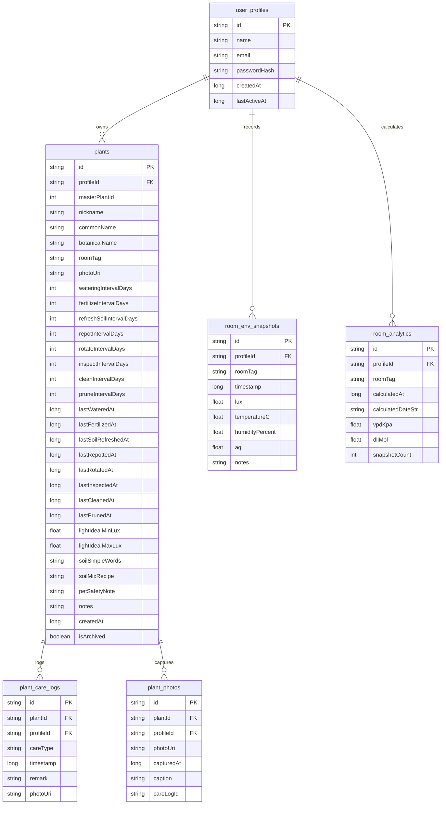

# Happy Plants — Product & Technical Design Document (v0.5)

**Working Title / Package**: *Happy Plants* (`com.hos.happy.plants`)  
**Version**: 0.5 (Updated with Implemented Architecture & Features)  
**Platform**: Android (Target SDK 35, Min SDK 26)  
**Architecture**: Offline-First, Clean Architecture + MVVM, Jetpack Compose, Material 3 Botanical Design System, Room DB (Schema v3), DataStore Preferences  

---

## 1. Executive Summary & Vision

*Happy Plants* is an offline-first companion application tailored for indoor, balcony, and desk plant care in Indian urban environments (Mumbai, Delhi, Bengaluru, Kolkata, Pune, etc.). The app eliminates anxiety around plant care through:

1. **A Calm, Actionable Daily Care Dashboard**: Separating what is **Essential** (e.g. Watering) from what is **Good to Have** (e.g. rotating pots, leaf cleaning).
2. **Environment & Micro-climate Tracking**: Real-time ambient light measurement (hardware lux sensor + CameraX fallback), weather integration, and room-level Vapor Pressure Deficit (VPD) and Daily Light Integral (DLI) calculations.
3. **Master Plant Encyclopedia**: Bundled offline catalog of Indian indoor plant species with resolved Wikipedia images, seasonal watering guidelines, soil recipes, and common problem diagnostics.
4. **Interactive Plant Care Doctor & Growth Journey**: Step-by-step diagnostic advice for yellowing leaves, pests, and root rot, paired with an animated chronological growth photo slideshow.

---

## 2. Architecture & Design Principles

### 2.1 Core Architectural Pillars
* **100% Offline-First**: No mandatory sign-in, cloud dependency, or external database required for daily logging, plant health diagnostics, or light measurement.
* **Local Multi-Profile Architecture**: Multi-profile system stored in local Room DB (`user_profiles`). Each profile has independent plants, care logs, photos, and environmental snapshots. Profile switching is accessible anytime from the top bar.
* **Reactive State Management**: Built using Kotlin Coroutines, `StateFlow`, and Room Reactive Flows (`Flow<List<T>>`).
* **Hardware Adaptation**: Automatic detection of ambient light sensor capabilities with persistent caching in DataStore, gracefully falling back to CameraX luminance analysis on budget hardware.

### 2.2 Visual Design System (Botanical Palette)
Custom design tokens extending Material 3:
* **Forest (`#2E4A2A`)**: Primary brand color, headings, active bottom navigation icons.
* **Moss (`#4F6F3B`)**: Primary buttons, affirmative actions, active filter chips.
* **Leaf (`#A9C48B`)**: Accents, highlight containers, positive indicator badges.
* **Bark (`#6B4A2F`)**: Secondary text, botanical labels, subtle emphasis.
* **Sand (`#D8C8A4`)**: Card borders, divider lines, subtle outlines.
* **Paper (`#F3EFDF`)**: Warm secondary card surfaces and input backgrounds.
* **PaperDark (`#EDEADB`)**: Overall scaffold background for warm editorial feel.
* **SurfaceWarm (`#F7F5EC`)**: Primary card containers, modals, bottom sheets.
* **Ink (`#2B2118`)**: Primary high-contrast typography.
* **Mute (`#6B5D4D`)**: Secondary body text and hints.
* **AmberLight (`#E89828`)**: Caution, high light, upcoming maintenance indicators.
* **SkyBlue (`#4A89A6`)**: Weather, humidity, and atmospheric metrics.
* **Terracotta / Warn (`#8A4B22`)**: Overdue alerts, essential task highlights.

---

## 3. Database Architecture (Room Schema v3)



---

## 4. Feature Breakdown & Detailed Mechanics

### 4.1 Tab 1: Garden (`feature/garden`)

#### A. Segmented Navigation & Top Actions
* **Segmented Bar**: Smoothly toggles between `[ 📋 Today's Action ]` (with live due task count) and `[ 🪴 Garden ]` (with total plant count).
* **Prominent Add Plant**: Persistent Moss button in the top app bar and an Extended Floating Action Button (FAB).

#### B. The 7 Plant Care Activities & Scheduling Engine
Every plant tracks 7 horticultural activities:
1. **Watering (`WATER`)**: The most critical activity.
   - *Golden Rule*: *"Water only when the top 2–3 cm of soil is dry."*
   - *Day 1 Rule*: On initial plant registration, `lastWateredAt = null`. Watering is **immediately scheduled as DUE on Day 1** as an **Essential** task.
2. **Rotating the Pot (`ROTATE`)**:
   - *Golden Rule*: *"Turn the pot a quarter turn weekly so it grows evenly toward light."*
   - *Interval*: 7 days. Initialized as done on Day 1 (`lastRotatedAt = now`).
3. **Feeding (`FEED`)**:
   - *Golden Rule*: *"Manure or diluted fertiliser every 30–90 days during growing season."*
   - *Interval*: Sourced from master plant catalog (default 60 days). Initialized as done on Day 1.
4. **Pest Inspection (`INSPECT`)**:
   - *Golden Rule*: *"A weekly look under leaves and at stems catches problems while easy to fix."*
   - *Interval*: 7 days. Initialized as done on Day 1.
5. **Leaf Cleaning (`CLEAN`)**:
   - *Golden Rule*: *"Wiping dust off leaves opens pores and maximizes sunlight absorption."*
   - *Interval*: 14 days. Initialized as done on Day 1.
6. **Removing Dead Leaves / Pruning (`PRUNE`)**:
   - *Golden Rule*: *"Pruning yellow/brown leaves stops disease spread and saves energy."*
   - *Interval*: 14 days. Initialized as done on Day 1.
7. **Repotting (`REPOT`)**:
   - *Golden Rule*: *"Every 1–2 years so roots have room and soil remains fresh."*
   - *Interval*: Sourced from master data (default 730 days). Initialized as done on Day 1.

#### C. Today's Action Screen: Essential vs. Good-to-Have
Tasks are evaluated dynamically:
* 🚨 **Essential Today**:
  - Watering (always essential).
  - Any task severely overdue ($\ge 3$ days for rotation/inspection, $\ge 14$ days for feeding).
* ✨ **Good to Have Today**:
  - Routine rotation, leaf cleaning, pest inspection, and pruning.
* **Action Dialog**:
  - One-tap completion.
  - Optional observation note (e.g., *"Top 3 cm dry, gave 300ml RO water"*).
  - Optional photo attachment (automatically added to the plant's Growth Journey).

#### D. Garden Overview: Per-Room Grouping & Inline Expansion (No Modals)
* **Room Filter Chips**: Filter by `All`, `Living`, `Bed`, `Bathroom`, `Balcony`, or custom rooms.
* **Status Badges**: `💧 Thirsty`, `🔄 Rotate`, `🔍 Inspect`, `🌱 Feed`, `✨ Clean`, `✂️ Prune`, `🪴 Repot`, or `🌿 All Good`.
* **Zero-Modal Inline Expansion**: Clicking a card smoothly unfolds an inline accordion directly underneath:
  - **Soil Guidance & Mix Recipe**: Exact component ratios (e.g. *3 parts garden soil + 2 parts coarse sand + 1 part cocopeat*).
  - **7 Activities Calculated Table**: Live countdown showing exact status (e.g. *"🚨 Due Today"*, *"🟢 Due in 4 days"*, *"Overdue by 2d"*) with direct one-tap `"Done"` buttons for every activity.
  - **Recent Care History**: Chronological log of past completed activities.

#### E. 🩺 Care Doctor & Symptom Troubleshooting
* Uses the `common_problems` array from `indoor_plants_india.json`.
* Diagnostic questions prompt the user: *"Are lower leaves turning yellow, soil staying wet, or plant base feeling soft?"*
* Selecting a symptom reveals:
  - Diagnosis (e.g., *Root rot*, *Mealybugs*, *Spider mites*, *Leaf spot*).
  - Numbered, practical remedy steps (e.g., copper oxychloride ratios, neem oil recipe, isolation instructions).

#### F. 🌱 Plant Journey (Animated Slideshow)
* Auto-advancing visual timeline cycling through all photos captured for the plant over time.
* Fades smoothly between stages with capture date, time, and care remarks.
* Full playback controls: Play, Pause, Previous, Next, and photo index indicator.

#### G. Typeahead Add Plant
* Auto-complete search box filtering `indoor_plants_india.json` by common name, botanical name, or local Indian transliterations (Hindi, Marathi, Bengali, Kannada).
* Selecting a plant auto-populates species data, Wikipedia image, and default intervals.
* Allows inline creation of custom rooms on the fly.

---

### 4.2 Tab 3: Environment (`feature/env`)

#### A. Master Room Filter & Persistent Room Management
* Default fixed rooms: **`Living`**, **`Bed`**, **`Bathroom`**, **`Balcony`** (defaults to `Living`).
* Custom rooms saved to DataStore (`key_custom_room_tags`) and combined dynamically.
* Serves as the master auto-filter across the entire screen (snapshots, historical records, and VPD/DLI metrics).

#### B. Live Macro-Climate Cards
* Integrates Open-Meteo REST API using GPS location (`FusedLocationProviderClient`).
* Metrics tracked: Temperature (°C), Relative Humidity (%), Air Quality Index (AQI), UV Index, and Daylight Hours.

#### C. Dual-Engine Light Meter
* **Hardware Ambient Sensor**: Real-time reading in Lux via `Sensor.TYPE_LIGHT`.
* **Camera Fallback (CameraX)**: Custom `LuminanceAnalyzer` calculating approximate illuminance for phones lacking a hardware sensor.
* **Hardware Cache**: Queries hardware once on first install, caches result in DataStore, and eliminates redundant SensorManager queries.
* **Freeze / Hold**: Allows user to lock the current reading in place.

#### D. Advanced Room Analytics: VPD & DLI Daily Unlock
* **Vapor Pressure Deficit (VPD)**: Calculated using the Tetens formula for saturation vapor pressure vs. actual vapor pressure (expressed in kPa).
* **Daily Light Integral (DLI)**: Calculated from average lux, PPFD conversion factor ($54\text{ lx} \approx 1\,\mu\text{mol}\cdot\text{m}^{-2}\cdot\text{s}^{-1}$), and daylight duration (expressed in $\text{mol}\cdot\text{m}^{-2}\cdot\text{d}^{-1}$).
* **3-Slot Daily Measurement Unlock**:
  - Requires 3 measurements in a single day:
    - 🌅 **Morning** (before 12:00 PM)
    - ☀️ **Noon** (12:00 PM – 4:00 PM)
    - 🌇 **Afternoon / Evening** (after 4:00 PM)
  - Interactive stepper displays slot progress and exact recording times.
* **Persistent `room_analytics` Table**:
  - Calculates and stores the latest VPD and DLI values per room and profile.
  - If $\ge 3$ snapshots exist for a room, displays the last calculated values and calculation date immediately upon room selection.

#### E. Metric Info Modal (`?` Buttons)
* Non-scientific, plant-friendly explanations for every metric (Temperature, Humidity, AQI, UV, Daylight, LUX, VPD, DLI).
* Features an automatic **5-second countdown timer** that auto-closes the modal.

#### F. Room Snapshot History & Filtered Calendar
* Historical log of recorded room snapshots.
* Date picker with custom date validator enabling **only** dates that have recorded snapshots.

---

## 5. Technology Stack Summary

| Layer | Library / Tool | Purpose |
|---|---|---|
| **Language** | Kotlin 2.0.21 | Android native development |
| **UI Framework** | Jetpack Compose + Material 3 | Declarative, modern botanical UI |
| **Architecture** | MVVM + Repository pattern | Clean separation of business logic and UI |
| **Local DB** | Room 2.6.1 (SQLite) | Profiles, plants, care logs, photos, snapshots, analytics |
| **Preferences** | DataStore Preferences 1.1.1 | Caching hardware capabilities & custom room tags |
| **Image Loading** | Coil Compose 2.7.0 | Loading Wikipedia plant thumbnails & user photos |
| **Camera** | CameraX 1.4.1 | Light meter camera fallback & photo capture |
| **Location** | Play Services Location 21.3.0 | Coarse/fine GPS for macro-climate API |
| **Network** | HttpURLConnection (Standard SDK) | Lightweight Open-Meteo REST calls (zero overhead) |
| **Serialization**| Gson 2.11.0 | Offline parsing of `indoor_plants_india.json` |
| **JVM Target** | Java 17 | JDK 17 LTS compatibility |

---

## 6. Build & Deployment Verification

* **Gradle Configuration**: Gradle 8.11.1 running under Oracle JDK 17 LTS.
* **Build Artifact**: `app/build/outputs/apk/debug/app-debug.apk` (21 MB).
* **Install Command**:
  ```bash
  adb install -r "app/build/outputs/apk/debug/app-debug.apk"
  ```
